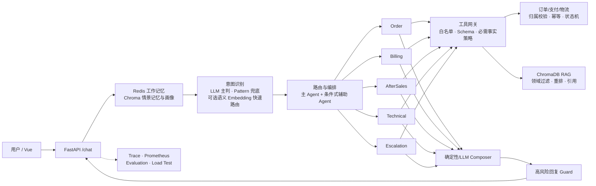
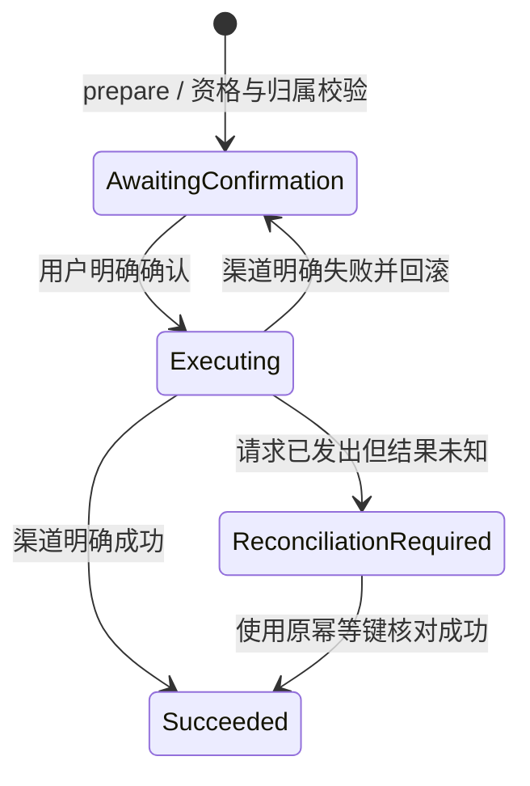

# CommerceMind · 可靠电商客服 Agent

> 让模型负责理解与表达，让代码负责权限、事实和交易安全。

[](https://www.python.org/)
[](https://fastapi.tiangolo.com/)
[](https://github.com/ianIanlan/CommerceMind/actions/workflows/ci.yml)
[](#验证结果)
[](docs/unified_benchmark_v1.md)
[](docs/external_amazonhelp_v1.md)
[](docs/transaction_reliability_v1.md)
[](LICENSE)

CommerceMind 是一个面向订单、物流、支付和售后的 Agent 应用工程原型。它不让模型直接决定业务结果：LLM 负责语义理解和回复生成，订单事实来自工具，高风险写操作由权限白名单、用户确认、数据库事务、幂等键和对账状态机共同约束。

项目重点不是“用了几个 Agent”，而是回答三个工程问题：**模型判断错误时如何限制影响、重复确认时如何避免重复交易、支付渠道超时时如何避免产生错误业务结论。**

## 一分钟看懂

| 核心问题 | 工程决策 | 可验证证据 |
|---|---|---|
| 模型会误判或漏调用工具 | LLM 主判、确定性 Pattern 兜底、必需只读事实策略 | AmazonHelp 零重叠 holdout 23/25；协议失败率4% |
| 单 Agent 工具过多、权限过大 | 按领域条件路由，Agent 只获得代码注册的工具白名单 | 36/36 工具与交易策略断言通过 |
| 重复点击可能产生重复退款 | `prepare → confirm → execute`、事务和支付幂等键 | 16线程并发确认仅执行一次；任务断言7/7 |
| 渠道可能成功但响应超时 | 独立 `reconciliation_required` 状态，用原幂等键核对 | 故障注入不误报成败、不产生第二笔退款 |
| 多领域请求容易漏处理 | 主 Agent + 条件式辅助 Agent 并发执行 | 32条编排集 Exact Match 87.50%，Micro-F1 95.83% |
| 系统能跑但问题不可定位 | Trace、阶段耗时、token usage、Monitor/Evaluation 分离 | 104项测试、消融、压测和逐样本错误报告 |

内部160条回归集用于稳定复现，外部80条脱敏 AmazonHelp 语料用于补充真实表达验证。两类数据都不代表生产流量准确率。

## 架构



```text
记忆读取 → 混合意图识别 → 条件路由 → Agent 并发执行
→ 受控工具/RAG → 回复整合 → Guard → 记忆写回 → Trace
```

### 高风险退款链路



模型只能提出待确认动作，不能绕过状态机直接写入退款结果。

## 关键设计

### 意图识别与成本路由

- LLM 处理口语、省略和复杂语义；其 `confidence` 是模型自评分，不冒充校准概率。
- Pattern 提供高信息量、低延迟的确定性证据和模型故障兜底。
- 多语言语义 Embedding 只有在相似度与 top1-top2 margin 均通过校准时才允许跳过 LLM。
- 外部验证中 Embedding 快速路径只覆盖4%，因此默认关闭，没有为了“三路融合”保留无效调用。
- 明确要求人工时走 Pattern 快速路径；模型失效时仍可本地降级。

### 条件式多 Agent

系统不会为了“多 Agent”而拆分所有请求。单领域问题只调用一个专家；只有跨领域消息才并行调用辅助 Agent。拆分的主要收益是工具权限隔离、上下文收敛和独立评估，代价是路由错误、成本和整合复杂度。

领域角色包括 General、Order、Billing、AfterSales、Technical 和 Escalation。主辅 Agent 不互相讨论，各自依据自己的输入契约和工具事实执行，最后统一合并。

### 工具治理与交易安全

- 每个 Agent 只有代码注册的工具白名单，Prompt 中写出工具名不会获得权限。
- 调用前校验 JSON Schema、必填字段和未知参数。
- 支付、物流等关键回答由策略预取必需的只读事实，降低模型漏调用概率。
- 退款、取消订单和修改地址采用 `prepare → confirm → execute`；prepare 不改变业务状态。
- 服务层验证订单归属并使用幂等键，重复确认不会重复退款。

### 失败路径与可观测性

- Agent 有完整调用时间预算，而不只限制单次 HTTP 请求。
- 超时时取消模型任务，保留已经获得的工具事实，并生成明确的降级回答。
- Trace 记录路由、工具、Guard、降级原因及各阶段耗时。
- `/chat` 记录请求级模型调用次数和 token；只有配置真实供应商单价时才计算美元成本。
- Monitor 负责运行状态，Evaluation 负责结果质量，二者不混用。

## 验证结果

### 统一评测集

评测集共 160 条，统一 Schema、稳定 case ID 和 SHA-256，覆盖直接表达、口语、否定、多领域、RAG 拒答、工具越权和交易状态机。

| 任务 | 数量 | 主指标 | 结果 |
|---|---:|---|---:|
| 意图识别生产策略 | 70 | Accuracy / Macro-F1 | 92.86% / 90.04% |
| 条件式多 Agent 编排 | 32 | Exact Match / Micro-F1 | 87.50% / 95.83% |
| RAG 检索 | 22 | Hit@3 / MRR | 78.95% / 0.763 |
| 工具与交易策略 | 36 | Pass Rate | 100% |

项目另从公开 AmazonHelp 客服对话构建脱敏外部评测：55 条诊断集上，真实模型生产融合从 **45.45%** 提升到 **89.09%**，LLM 协议失败率由 **23.64%** 降到 **3.64%**；随后在零重叠、只运行一次的 25 条 holdout 上取得 **92.00% Accuracy**（95% CI 75.03%–97.78%）。标签为项目审阅的 silver label，结果不等同于线上生产准确率；完整口径见 [AmazonHelp 外部实验](docs/external_amazonhelp_v1.md)。

多语言语义 Embedding 采用选择性成本路由：阈值只在55条诊断集上校准，在25条冻结验证集上以 **100% 路由精度覆盖1条请求（4%）**。收益不足以默认开启，因此生产默认仍由 LLM 主判；完整负结果见[语义 Embedding 实验](docs/semantic_embedding_experiment.md)。

报告保留了 5 个意图错误、4 个多领域漏路由和 4 个 RAG 漏召回，没有隐藏失败样本。

```bash
# 离线、零模型成本
.runtime-venv/bin/python scripts/build_benchmark_v1.py
.runtime-venv/bin/python scripts/run_unified_benchmark.py

# 实时模型意图实验
.runtime-venv/bin/python scripts/run_unified_benchmark.py --live-llm
```

### 并发压测

| 链路 | 并发 | 请求数 | P95 | 吞吐 | 错误/降级 |
|---|---:|---:|---:|---:|---:|
| 确定性快速路径 | 20 | 20 | 358.2 ms | 55.313 req/s | 0% / 0% |
| 真实模型链路 | 10 | 10 | 10,713.0 ms | 0.888 req/s | 0% / 0% |

真实模型压测三档累计 30 个请求、52 次模型调用、89,901 输入 token 和 29,066 输出 token。第三方网关未配置可审计单价，因此金额成本为 `N/A`，不是零。完整口径见[并发压测报告](docs/load_test_v1.md)。

### 自动化与故障实验

- 104 项自动化测试通过。
- 7/7 任务级状态断言通过；支付渠道结果未知时进入 reconciliation，而不是错误宣称退款成败。
- Composer 确定性与 LLM 模式各 10 次对照。
- 必需只读工具策略开启/关闭各 10 次对照。
- Agent 1 秒超时故障注入，验证事实保留与降级。
- Docker 场景验证路由、越权隔离、退款确认和幂等。

实验索引：[性能优化](docs/performance_optimization_v1.md) · [Composer 消融](docs/composer_ablation_v1.md) · [必需工具策略](docs/required_tool_policy_experiment_v1.md) · [时间预算](docs/agent_timeout_budget_v1.md) · [高风险交易可靠性](docs/transaction_reliability_v1.md)

## 快速启动

### Docker 全栈

默认命令启动 API、PostgreSQL、Redis、ChromaDB 和 Prometheus，不依赖仓库外目录：

```bash
cp .env.example .env
# 在不提交 Git 的 .env.local 中填写真实 API Key
docker compose up -d --build
docker compose ps
```

- API / Swagger：`http://localhost:8000` / `http://localhost:8000/docs`
- Health：`http://localhost:8000/health`
- Prometheus：`http://localhost:9090`

Vue 工作台维护在独立前端目录。将它放在后端同级的 `CommerceMindFrontend` 后启动可选 UI profile：

```bash
docker compose --profile ui up -d --build
```

前端地址：`http://localhost`。也可通过 `COMMERCEMIND_FRONTEND_CONTEXT` 指定其他前端路径。这样单独 clone 后端不会因为缺失前端目录而构建失败。

完整说明见 [Docker 快速启动](docs/docker_quickstart.md)。

### 无 Docker 的本地演示

```bash
python3 -m venv .runtime-venv
.runtime-venv/bin/pip install -r requirements-local.txt
./scripts/run_local.sh
```

本地模式使用进程内记忆、轻量检索与 SQLite；完整模式使用 Redis、ChromaDB 和 PostgreSQL。默认用户为 `demo-user`，可测试 `ORD-10002` 物流、`ORD-10005` 重复扣款和 `ORD-10003` 售后确认。

## API 示例

```bash
curl -X POST http://localhost:8000/chat \
  -H 'Content-Type: application/json' \
  -d '{"user_id":"demo-user","message":"订单 ORD-10005 为什么扣了两次款"}'
```

| 接口 | 作用 |
|---|---|
| `POST /chat` | 完整 Agent 链路 |
| `GET /trace/tool/{request_id}` | 请求级路由、工具与阶段证据 |
| `POST /commerce/refunds/prepare` | 创建待确认退款动作 |
| `POST /actions/{action_id}/confirm` | 幂等确认动作 |
| `POST /search` | RAG 检索与重排 |
| `GET /monitor` / `GET /metrics` | 运行观测 |

生产身份模式设置 `AUTH_MODE=signed_token` 和 `AUTH_SECRET`；此时服务端忽略客户端传入的 `user_id`，只信任签名 Token 的 `sub`。

## 项目结构

```text
api/          FastAPI 主链路、鉴权和响应契约
agents/       Agent 角色、路由、并发编排、工具白名单
commerce/     订单/支付/退款事实、状态机、幂等与审计
core/         意图识别、模型适配、Embedding、usage 计量
memory/       Redis/Chroma 分层记忆
mcp/          RAG、重排、缓存和熔断
evaluation/   消融、统一评测与任务指标
monitor/      Trace、运行指标与告警
data/eval/    版本化内部回归集与脱敏 AmazonHelp 外部集
scripts/      实验、压测和验收入口
docs/         设计、实验结果与证据边界
```

## 项目边界

这是接近生产架构的工程原型，不宣称已经生产化：

- 内部评测是合成回归数据；外部 AmazonHelp 是公开真实表达，但采用单轮审阅 silver label，尚未双人独立标注。
- 订单、支付和物流遵循真实接口语义，但默认仍是演示数据与模拟渠道。
- 当前 P95 主要受第三方模型影响，尚未完成多副本扩容和长时间稳定性压测。
- LLM confidence 未做概率校准；LLM-as-Judge 不能代替人工盲评。
- RAG Hit@3 仍有提升空间，失败样本已保留在报告中。

## 文档入口

- [系统设计](docs/commerce_agent_design.md)
- [面试讲解与追问手册](docs/interview_playbook.md)
- [高风险交易可靠性](docs/transaction_reliability_v1.md)
- [AmazonHelp 外部实验](docs/external_amazonhelp_v1.md)
- [统一评测报告](docs/unified_benchmark_v1.md)
- [并发压测报告](docs/load_test_v1.md)
- [项目完成度与路线](docs/project_review_and_roadmap.md)
- [业务流程说明](wiki/业务流程说明.md)
- [完整使用指南](wiki/完整使用指南.md)

---

一句话总结：**CommerceMind 研究的不是“怎样让客服说得更像人”，而是“怎样让 Agent 在真实业务约束下正确路由、安全执行、失败可控，并且能被实验验证”。**
